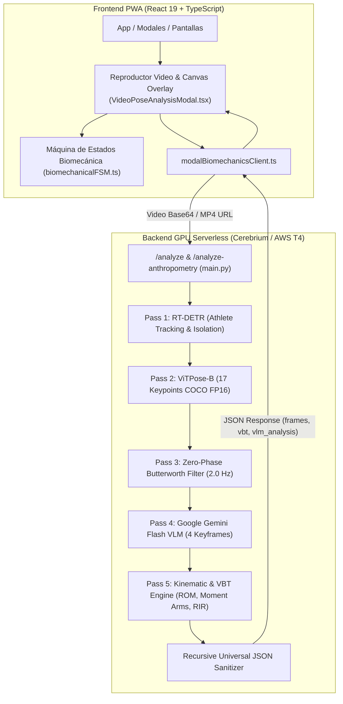

# MIA & Strength Biomechanics Engine — Especificación Técnica Integral de Arquitectura, Algoritmos y Código

> **Propósito de este documento:** Proveer a cualquier agente de inteligencia artificial o desarrollador independiente un contexto técnico, exhaustivo y quirúrgico del ecosistema completo de la aplicación **MIA**: stack tecnológico, estructura de código, pipelines de visión por computador, modelos de IA, motores biomecánicos y algoritmos matemáticos en frontend y backend.

---

## 1. Visión General del Producto y Arquitectura

**MIA** es una aplicación integral de entrenamiento de fuerza, hipertrofia basada en biomecánica, nutrición y análisis cinemático mediante visión artificial (VLM + Pose Estimation).

El sistema opera bajo un desacoplamiento estricto:
- **Frontend SPA (PWA):** React 19 + TypeScript + Vite + Tailwind CSS v4. Gestiona la UX del entrenamiento, rutinas inteligentes, escáner nutricional, cálculo de balances energéticos y el reproductor de vídeo con renderizado de canvas 2D superpuesto (`requestAnimationFrame`).
- **Backend de Inferencia Biomecánica (GPU Serverless):** Python 3.11 alojado en **Cerebrium** (AWS `us-east-1`, GPU NVIDIA Turing T4). Orquesta inferencia neuronal por lotes (RT-DETR + ViTPose-B) y consulta multimodal a **Google Gemini 2.5 Flash / 3.5 Flash Lite** para clasificación biomecánica y resolución física de vectores de fuerza.



---

## 2. Stack de Herramientas y Dependencias

### 2.1. Frontend (`package.json`)
| Herramienta / Librería | Versión | Rol en la Aplicación |
| :--- | :--- | :--- |
| **React / React-DOM** | `^19.3.1` | Renderizado declarativo y gestión de estado reactivo. |
| **TypeScript** | `~6.0.3` | Tipado estático estricto (no `any` silenciosos en tipos críticos). |
| **Vite** | `^8.3.4` | Bundler ultrarrápido y entorno de desarrollo ESM. |
| **Tailwind CSS** | `^4.3.3` | Motor de estilos utilitarios modernos con `@tailwindcss/vite`. |
| **Lucide React** | `^1.60.0` | Iconografía del sistema. |
| **Canvas Confetti** | `^1.9.4` | Animaciones de celebración de récords y fin de sesión. |
| **Zod** | `^4.6.7` | Validación de esquemas de datos y contratos API. |
| **@mediapipe/tasks-vision** | `^1.2.0` | Detección de pose local en cliente (fallback ligero sin red). |
| **Vitest** | `^5.0.5` | Suite de tests unitarios e integración. |
| **Oxlint** | `^1.88.0` | Linter de alto rendimiento en Rust. |

### 2.2. Backend (`cerebrium.toml` & `main.py`)
| Herramienta / Librería | Versión | Rol en el Backend |
| :--- | :--- | :--- |
| **Cerebrium Runtime** | Python 3.11 | Despliegue serverless de GPU con auto-escalado a 0 réplicas. |
| **PyTorch & Torchvision** | `>=2.2.0 / 0.17.0` | Motor de tensores y aceleración CUDA en GPU T4. |
| **Transformers (HuggingFace)** | `>=4.48.0` | Pipeline de inferencia para RT-DETR y ViTPose. |
| **OpenCV (`opencv-python-headless`)** | `>=4.9.0` | Lectura de contenedores de vídeo, muestreo de frames y codificación JPEG. |
| **SciPy** | `>=1.12.0` | Filtros digitales (Butterworth, `filtfilt`, splines cúbicos, filtros de mediana). |
| **NumPy** | `>=1.26.0` | Álgebra lineal, cálculo vectorial ortogonal y proyecciones. |
| **Pillow (PIL)** | `>=10.2.0` | Manipulación de imágenes para preparación de keyframes VLM. |
| **Google Gemini REST API** | v1beta | Modelo de Lenguaje Visual (`gemini-2.5-flash` / `gemini-3.5-flash-lite`). |

---

## 3. Arquitectura del Backend de Visión Artificial (`backend/main.py`)

El backend expone el endpoint principal `/analyze` optimizado para devolver el análisis de una serie completa en **< 3 segundos**.

### Pipeline de 5 Fases de Inferencia:

#### Fase 1: Detección y Seguimiento Temporal del Atleta (RT-DETR)
- **Modelo:** `PekingU/rtdetr_r50vd_coco_o365`.
- **Optimización de carga:** Muestrea 1 de cada 3 frames y realiza interpolación lineal por tramos de los bounding boxes para los frames intermedios (reduce el tiempo de detector en un **66%**).
- **Aislamiento del atleta:** Si hay múltiples personas en el gimnasio, selecciona y bloquea al usuario evaluando:
  $$\text{Score} = \text{Área}(B) \times (1.0 - 0.8 \times \text{DistanciaAlCentro}) \times \text{Confianza}$$
- **Suavizado de caja:** Media móvil temporal (ventana = 5) para eliminar temblores de recorte antes de entrar a ViTPose.

#### Fase 2: Estimación de Pose en Lotes (ViTPose-B)
- **Modelo:** `usyd-community/vitpose-base-simple`.
- **Inferencia por lotes:** Procesa los recortes del atleta en batch de 64 imágenes en precisión media (`fp16`) en GPU.
- **Topología:** Extrae las 17 articulaciones COCO:
  `nose`, `left/right_eye`, `left/right_ear`, `left/right_shoulder`, `left/right_elbow`, `left/right_wrist`, `left/right_hip`, `left/right_knee`, `left/right_ankle`.
- Coordenadas normalizadas a $[0.0, 1.0]$ relativas al tamaño del vídeo original.

#### Fase 3: Filtrado de Señal Cinemática (Filtro Butterworth de Fase Cero)
- **Detección de cortes de plano:** Si el centroide del cuerpo o el área del bounding box salta $> 22\%$ entre frames adyacentes, se marca corte de escena (`SCENE_CUT`).
- **Interpolación previa:** Frames aislados con confianza $< 0.25$ se interpolan linealmente. Salto de articulaciones $> 0.07$ en 1 frame (aleteo de ropa o sudadera ancha) se descartan como outliers.
- **Filtro Butterworth Bidireccional:**
  - Frecuencia de corte: $f_c = 2.0\text{ Hz}$ (o $1.8\text{ Hz}$ en señales continuas), $f_s = 15.0\text{ Hz}$, orden $N = 2$.
  - Se ejecuta mediante `scipy.signal.filtfilt` por segmentos continuos entre cortes de escena para garantizar **cero desfase temporal** (fase cero).

#### Fase 4: Orquestador Biomecánico Multimodal (Gemini VLM)
- Extrae exactamente **4 keyframes representativos** del vídeo (codificados en Base64 JPEG al 65% de calidad).
- Invoca la API REST de Gemini con un esquema JSON estricto (`response_mime_type: "application/json"`).
- **Responsabilidades del VLM:**
  1. Identificar el ejercicio real dentro del catálogo (ej. `chest_press_machine`, `seated_row`, `rdl`).
  2. Identificar el plano de cámara (`lateral_right`, `lateral_left`, `frontal`, `contrapicado`).
  3. Indicar el lado anatómico activo (`active_working_side`: `left` o `right`).
  4. Resolver el vector de fuerza 2D real $(\hat{u}_x, \hat{u}_y)$ de la máquina, polea o carga libre.
  5. Dictar si se oculta la línea de torso o cuello (`hide_torso_line`, `hide_neck_line`) para evitar líneas cruzadas en bancos o máquinas de pecho.

#### Fase 5: Motor Cinemático, Repeticiones y VBT
- **Segmentación de repeticiones:** Detección de picos y valles sobre la señal primaria de ROM (`find_peaks` con distancia mínima temporal de $0.85\text{ s}$ y prominencia $> 15^\circ$).
- **Fases frame a frame:** `IDLE` $\to$ `ECCENTRIC` $\to$ `BOTTOM` $\to$ `CONCENTRIC` $\to$ `LOCKOUT`.
- **VBT (Velocity-Based Training):**
  - Velocidad concéntrica media (MCV) en $\text{deg/s}$ o $\text{m/s}$.
  - Pérdida de velocidad (% fatiga intra-serie):
    $$\text{Fatigue \%} = \frac{V_{\text{first}} - V_{\text{last}}}{V_{\text{first}}} \times 100$$
  - Estimación precisa de **RIR** (Reps in Reserve) calibrado por velocidad mínima de fallo ($V_{\text{fail}}$).

#### Fase 6: Sanitizador Recursivo Universal de JSON
Convierte tipos NumPy (`int64`, `float64`, `ndarray`, `bool_`, `NaN`, `Inf`) a primitivas estándar de Python antes de serializar, erradicando fallos de serialización JSON en el runtime de Cerebrium.

---

## 4. Contrato de Datos de la API (`BiomechanicsFrame`)

Cada objeto devuelto en `frames[]` cumple con el siguiente esquema estricto:

```json
{
  "timestamp_sec": 1.4667,
  "phase": "CONCENTRIC",
  "rep_index": 2,
  "body_region": "upper",
  "angles": {
    "elbow": 88.4,
    "shoulder": 42.1,
    "hip": 175.2,
    "knee": 168.0,
    "neck": 12.3
  },
  "keypoints": {
    "shoulder": [0.4521, 0.3812],
    "elbow": [0.3820, 0.4415],
    "wrist": [0.3410, 0.3920],
    "hip": [0.4812, 0.6521],
    "knee": [0.5012, 0.7812],
    "ankle": [0.5120, 0.9210],
    "ear": [0.4610, 0.3120]
  },
  "force_vector": {
    "origin": [0.3410, 0.3920],
    "ux": 0.8660,
    "uy": -0.5000,
    "d_primary_px": 142.5,
    "d_secondary_px": 35.2,
    "primary_pct": 80.2,
    "secondary_pct": 19.8,
    "primary_short": "P",
    "secondary_short": "T",
    "direction": "along_cable"
  }
}
```

---

## 5. Arquitectura del Frontend (`src/`)

### 5.1. Módulos y Pantallas Principales
- **`App.tsx`:** Orquestador central de estado de la aplicación (sesiones activas, sincronización local y nube, pestañas inferiores).
- **`ActiveWorkoutScreen.tsx`:** Interfaz de entrenamiento activo en sala: series, RPE, RIR, temporizador de descanso, pesos y repeticiones.
- **`VideoPoseAnalysisModal.tsx`:** Modal quirúrgico de análisis cinemático de vídeo.
  - Sincroniza el `<video>` con el `<canvas>` overlay a 60 FPS mediante `requestAnimationFrame`.
  - Contiene el selector de recorte (`trimStart`, `trimEnd`) y zoom/pan interactivo.
  - Soporta **Modo 1 (Corrección Técnica)** y **Modo 2 (Optimización Biomecánica)**.
- **`DualAnatomicalMap.tsx`:** Visualizador corporal SVG de fatiga muscular acumulada y volumen efectivo.
- **`FatSecretNutritionScreen.tsx` & `BarcodeScannerModal.tsx`:** Seguimiento de macros y calorías con base de datos española y escáner de códigos de barras (OpenFoodFacts API).
- **`FoodPhotoAiScannerModal.tsx`:** Escaneo de platos de comida por imagen asistido por IA.
- **`SmartRoutineWizardModal.tsx`:** Generador de rutinas inteligentes según nivel, días disponibles y equipamiento del gimnasio.
- **`MachineSubstitutionModal.tsx`:** Algoritmo de equivalencia biomecánica para sustituir máquinas ocupadas por alternativas con curvas de resistencia análogas.

### 5.2. Servicios y Clientes (`src/services/` y `src/utils/`)
- **`modalBiomechanicsClient.ts`:** Cliente HTTP con timeout, reintentos y compatibilidad retroactiva para comunicarse con Cerebrium / Modal.
- **`biomechanicalFSM.ts`:** Máquina de estados finitos que valida en tiempo real si una repetición es válida según umbrales de ROM mínimo e inflexión.
- **`kinematicAnalysisEngine.ts`:** Cálculo de ángulos articulares en 2D a partir de producto escalar y arcotangente bi-vectorial:
  $$\theta = \arccos\left(\frac{\vec{u} \cdot \vec{v}}{\|\vec{u}\| \|\vec{v}\|}\right) \times \frac{180}{\pi}$$
- **`oneEuroFilter.ts`:** Implementación del filtro $1€$ (Casiez et al.) para filtrado adaptativo en tiempo real minimizando jitter a baja velocidad y lag a alta velocidad.
- **`machinePhysicsEngine.ts`:** Modelado físico de levas elípticas, poleas desmultiplicadas y perfiles de resistencia mecánica (acortamiento vs estiramiento).

---

## 6. Algoritmos Clave Implementados

### 6.1. Sincronización Temporal 1:1 Vídeo $\leftrightarrow$ Esqueleto
En [`VideoPoseAnalysisModal.tsx`](file:///C:/Users/Pablo/.gemini/antigravity/scratch/mia/src/components/VideoPoseAnalysisModal.tsx):
- Se erradica el cálculo por FPS fijos.
- Se lee el `currentTime` del elemento HTML5 `<video>` restando el desplazamiento del corte inicial (`trimStart`).
- Se localiza el frame correspondiente mediante **búsqueda binaria** en el array de `frames` ordenado por `timestamp_sec`.
- Si el reproductor se encuentra entre dos marcas temporales analizadas, se calcula una **interpolación lineal hermítica (LERP)** de los keypoints normalizados para lograr movimiento a 60 FPS sin saltos ni tirones.

### 6.2. Mapeo Geométrico del Canvas con `object-contain`
Para evitar desfases entre el esqueleto y el cuerpo del atleta en vídeos verticales (9:16) reproducidos en pantallas horizontales (o viceversa):
```typescript
const videoRatio = video.videoWidth / video.videoHeight;
const canvasRatio = canvas.width / canvas.height;
let drawW = canvas.width;
let drawH = canvas.height;
let offsetX = 0;
let offsetY = 0;

if (videoRatio > canvasRatio) {
  drawH = canvas.width / videoRatio;
  offsetY = (canvas.height - drawH) / 2;
} else {
  drawW = canvas.height * videoRatio;
  offsetX = (canvas.width - drawW) / 2;
}

const px = (normX: number) => offsetX + normX * drawW;
const py = (normY: number) => offsetY + normY * drawH;
```

### 6.3. Cálculo de Brazos de Momento Perpendiculares en 2D
Dada una línea de fuerza que pasa por el punto de anclaje $\mathbf{P}_0 = (x_0, y_0)$ con vector director unitario $\hat{\mathbf{u}} = (u_x, u_y)$, y una articulación activa $\mathbf{J} = (x_j, y_j)$:
1. **Parámetro de proyección:**
   $$t = (\mathbf{J} - \mathbf{P}_0) \cdot \hat{\mathbf{u}} = (x_j - x_0) u_x + (y_j - y_0) u_y$$
2. **Punto proyectado ortogonal sobre la recta de fuerza:**
   $$\mathbf{P}_{\text{proj}} = \mathbf{P}_0 + t \cdot \hat{\mathbf{u}}$$
3. **Brazo de momento (distancia perpendicular):**
   $$d_{\perp} = |(x_j - x_0) u_y - (y_j - y_0) u_x|$$
4. **Reparto porcentual de torque entre articulaciones activas:**
   $$\%_{\text{primario}} = \frac{d_{\text{articulación 1}}}{d_{\text{articulación 1}} + d_{\text{articulación 2}}} \times 100$$

### 6.4. Algoritmo Anti-Colisión de Píldoras Telemetricas en Canvas
Cuando dos articulaciones (ej. hombro y codo, o cadera y rodilla) tienen cotas perpendiculares muy próximas en pantalla ($\Delta < 26\text{ px}$):
```typescript
if (Math.hypot(tag1X - tag2X, tag1Y - tag2Y) < 26) {
  if (tag1Y <= tag2Y) {
    tag1Y -= 13;
    tag2Y += 13;
  } else {
    tag1Y += 13;
    tag2Y -= 13;
  }
}
```

---

## 7. Despliegue e Infraestructura

1. **Frontend PWA:**
   - Compilación: `npm run build` (`tsc -b && vite build`).
   - Servidor de entrega: Netlify / Nginx PWA con cabeceras de caché estricta para assets e inmutabilidad de bundles.
   - Paquete de despliegue zip: `dist-netlify.zip`.
2. **Backend GPU:**
   - Plataforma: Cerebrium (`cerebrium.toml`).
   - Comando de despliegue: `cerebrium deploy --yes --detach`.
   - Id de aplicación: `p-88374926-biomechanics-engine`.
   - Endpoint productivo: `https://api.ccloud.cerebrium.ai/v4/p-88374926-biomechanics-engine/analyze`.

---

## 8. Guía Rápida para el Agente Autónomo

Cuando recibas una tarea sobre este repositorio:
1. **Para fallos de dibujo o sincronización visual:** Revisa [`src/components/VideoPoseAnalysisModal.tsx`](file:///C:/Users/Pablo/.gemini/antigravity/scratch/mia/src/components/VideoPoseAnalysisModal.tsx) en el bucle `renderCanvasOverlay` y `getPoint()`. Comprueba siempre si el ejercicio es `upper` o `lower`.
2. **Para fallos de inferencia neuronal o clasificación VLM:** Revisa [`backend/main.py`](file:///C:/Users/Pablo/.gemini/antigravity/scratch/mia/backend/main.py). Recuerda que la llamada a Gemini utiliza el endpoint REST con soporte de modelos flash y fallback cinemático local si no se suministra API key.
3. **Verificación continua obligatoria:**
   - En backend: compilar con `python -m py_compile backend/main.py`.
   - En frontend: typecheck con `npx tsc --noEmit` y test de build con `npm run build`.
   - Sincronizar siempre los cambios del directorio `mia` hacia el repositorio `strength-biomechanics-engine` antes de hacer commit.
