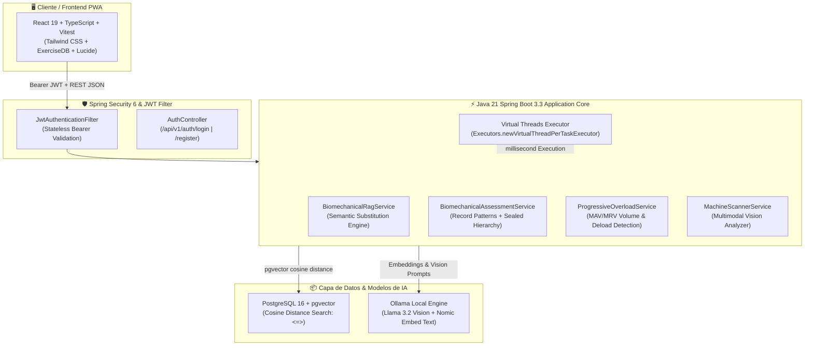

# 🏋️‍♂️ Biomechanics & Hypertrophy AI Engine (MIA Strength Lab)

[](https://openjdk.org/projects/jdk/21/)
[](https://spring.io/projects/spring-boot)
[](https://spring.io/projects/spring-ai)
[](https://github.com/pgvector/pgvector)
[](https://www.docker.com/)
[](https://jwt.io/)
[](http://localhost:8080/swagger-ui.html)
[](https://testcontainers.com/)
[](https://react.dev/)

> **Engine backend de alto rendimiento para biomecánica deportiva, prescripción hipertrófica y sustitución vectorial de maquinaria gym.**  
> Diseñado bajo arquitectura hexagonal limpia (DDD) con **Java 21**, **Spring Boot 3.3+**, **Spring AI Multimodal**, **PostgreSQL con pgvector** y **Virtual Threads (Project Loom)**.

---

## 🏛️ Arquitectura del Sistema



---

## 🚀 Puntos Clave del Stack Tecnológico Backend

### 1. Lenguaje: Java 21 LTS
- **Java 21 Records:** Utilizados como DTOs inmutables y contratos de dominio seguros (`AuthRequest`, `BiomechanicalAlternativeDto`, `PlateauAlertDto`, `WeeklyVolumeSummaryDto`).
- **Pattern Matching for Switch & Record Deconstruction (JEP 440 & 441):** Jerarquía sellada (`sealed interface BiomechanicalAssessment permits ...`) con evaluación exhaustiva sin cláusula default requerida.
- **Virtual Threads (Project Loom):** Concurrencia masiva habilitada nativamente (`spring.threads.virtual.enabled: true`) y `ExecutorService` con hilos virtuales para procesamiento simultáneo de biomecánica.

### 2. Framework: Spring Boot 3.3+
- **Spring Data JPA & Hibernate 6:** Mapeo de entidades complejas con soporte de tipos vectoriales.
- **Spring Security 6 con JWT (jjwt 0.12.6):** Autenticación sin estado (Stateless), CORS configurado para producción, hashing BCrypt, filtros personalizados `OncePerRequestFilter`.
- **Spring AI (Ollama Starter):**
  - Generación de embeddings semánticos (768 dimensiones con `nomic-embed-text`).
  - Reconocimiento multimodal de maquinaria deportiva (`llama3.2-vision`) para clasificar palancas, poleas y perfiles de resistencia a partir de fotos.

### 3. Persistencia: PostgreSQL 16 con pgvector
- Almacenamiento híbrido: Datos relacionales transaccionales (rutinas, usuarios, series, RPE, tonelaje) y embeddings vectoriales (`vector(768)`).
- Búsqueda de ejercicios y máquinas por **distancia coseno (`<=>`)**, permitiendo sustitución inteligente cuando un usuario reporta dolor articular (ej: pinzamiento subacromial o cizallamiento patelar).

### 4. Infraestructura & Contenedores: Docker Compose
- Orquestación en un solo comando:
  - `postgres` (`pgvector/pgvector:pg16` con inicialización `init.sql`).
  - `ollama` (`ollama/ollama:latest` con persistencia de modelos).
  - `backend` (Spring Boot 3.3.4 en Eclipse Temurin JRE 21 Alpine con ZGC generational y usuario no root).
  - `frontend` (React 19 compilado con Nginx reverse-proxy integrado).

### 5. Calidad & Pruebas: JUnit 5, Mockito & Testcontainers
- Pruebas unitarias completas con **JUnit 5** y **Mockito** para servicios de dominio, RAG, seguridad y algoritmos de sobrecarga progresiva.
- **Testcontainers:** Pruebas de integración sobre un contenedor PostgreSQL real con la extensión `pgvector` activada (`BiomechanicalPersistenceIntegrationTest.java`).
- Frontend cubierto por **65 tests unitarios e integrados** en Vitest.

### 6. Documentación de API: OpenAPI 3 & Swagger UI
- Especificación viva y ejecutable interactiva en `/swagger-ui.html` y `/api-docs`.
- Esquemas `@Schema`, códigos de respuesta `@ApiResponse` y descripciones operativas documentadas para cada endpoint REST.

---

## 💻 Demostración de Código Java 21

### Pattern Matching exhaustivo con Jerarquía Sellada (Sealed Types)
```java
public sealed interface BiomechanicalAssessment permits
        BiomechanicalAssessment.OptimalHypertrophy,
        BiomechanicalAssessment.AxialFatigueRisk,
        BiomechanicalAssessment.JointStressWarning,
        BiomechanicalAssessment.PlateauDetected {

    record OptimalHypertrophy(String targetMuscle, int effectiveWeeklySets, double mechanicalTonnageKg) implements BiomechanicalAssessment {}
    record AxialFatigueRisk(String exerciseName, double axialLoadingFactor, String correctiveRecommendation) implements BiomechanicalAssessment {}
    record JointStressWarning(String anatomicalJoint, String restrictedMovementPlane, String recommendedSubstituteMachine) implements BiomechanicalAssessment {}
    record PlateauDetected(String exerciseName, int consecutiveStagnantWeeks, double recommendedDeloadPercentage) implements BiomechanicalAssessment {}
}

// Evaluación en servicio mediante Pattern Matching switch expression (Java 21)
public String formulateActionPlan(BiomechanicalAssessment assessment) {
    return switch (assessment) {
        case BiomechanicalAssessment.OptimalHypertrophy(var muscle, var sets, var tonnage) ->
                "Progreso óptimo en %s: %d series efectivas completadas (tonelaje: %.1f kg).".formatted(muscle.toUpperCase(), sets, tonnage);

        case BiomechanicalAssessment.AxialFatigueRisk(var exercise, var factor, var rec) ->
                "Alerta de fatiga en columna axial para '%s' (Factor: %.2f). %s".formatted(exercise, factor, rec);

        case BiomechanicalAssessment.JointStressWarning(var joint, var plane, var substitute) ->
                "Cizallamiento en %s (Plano: %s). Reemplazo prescrito: %s.".formatted(joint, plane, substitute);

        case BiomechanicalAssessment.PlateauDetected(var exercise, var weeks, var deload) ->
                "Estancamiento en '%s' tras %d semanas. Aplicar deload del %.0f%%.".formatted(exercise, weeks, deload * 100);
    };
}
```

### Búsqueda Vectorial Semántica con pgvector
```java
@Query(value = """
    SELECT * FROM biomechanical_exercises e
    WHERE (:muscle IS NULL OR LOWER(e.target_muscle) = LOWER(:muscle))
    ORDER BY e.embedding <=> cast(:queryVector as vector)
    LIMIT :maxResults
    """, nativeQuery = true)
List<BiomechanicalExercise> findSimilarExercises(
        @Param("queryVector") String queryVector,
        @Param("muscle") String muscle,
        @Param("maxResults") int maxResults
);
```

---

## 🛠️ Ejecución Local con Docker Compose

Requisitos:
- Docker Engine 24+ y Docker Compose v2+
- Git

### 1. Clonar el repositorio y arrancar la infraestructura
```bash
git clone https://github.com/pabmatang/strength-biomechanics-engine.git
cd strength-biomechanics-engine

# Construir y levantar PostgreSQL (pgvector), Ollama, Backend y Frontend
docker compose up -d --build
```

### 2. Verificar el estado de los servicios
```bash
docker compose ps
```

| Servicio | Puerto Host | Descripción |
| :--- | :--- | :--- |
| **Frontend PWA** | `http://localhost:3000` | Interfaz React 19 con animaciones 2D y análisis biomecánico |
| **Backend REST API** | `http://localhost:8080` | Spring Boot 3.3.4 con Java 21 y Virtual Threads |
| **Swagger UI** | `http://localhost:8080/swagger-ui.html` | Explorador interactivo OpenAPI 3 |
| **PostgreSQL pgvector** | `localhost:5432` | Base de datos relacional y vectorial (`mia_fitness`) |
| **Ollama Server** | `localhost:11434` | Inferencia local Llama 3.2 Vision y Nomic Embed |

### 3. Descargar modelos de IA en Ollama (Primera ejecución)
```bash
docker exec -it mia_ollama ollama pull llama3.2-vision
docker exec -it mia_ollama ollama pull nomic-embed-text
```

---

## 🧪 Ejecución de Tests

### Backend (JUnit 5, Mockito & Testcontainers)
```bash
cd backend
mvn test
```

### Frontend (Vitest - 65 Tests en verde)
```bash
cd frontend
npm install
npm test
```

---

## 📂 Estructura del Proyecto

```
strength-biomechanics-engine/
├── docker-compose.yml              # Orquestación multicontenedor completa
├── README.md                       # Documentación técnica de arquitectura
├── LICENSE                         # Licencia MIT
├── .gitignore                      # Reglas de exclusión para Maven, Node y OS
│
├── backend/                        # Java 21 + Spring Boot 3.3.4 Engine
│   ├── pom.xml                     # Maven POM con dependencias Spring AI, pgvector, JWT
│   ├── Dockerfile                  # Multi-stage Eclipse Temurin 21 JRE Alpine + ZGC
│   ├── init.sql                    # Script de inicialización PostgreSQL + CREATE EXTENSION vector
│   └── src/
│       ├── main/java/com/mia/fitness/
│       │   ├── application/dto/    # Java 21 Records (Auth, Biomechanics, Plateau, Volume)
│       │   ├── application/service/# BiomechanicalRagService, Assessment, Overload
│       │   ├── domain/model/       # BiomechanicalAssessment (Sealed), Workout, Exercise
│       │   ├── infrastructure/
│       │   │   ├── persistence/    # BiomechanicalExerciseRepository con pgvector native queries
│       │   │   ├── security/       # JwtService, JwtAuthenticationFilter, SecurityConfig
│       │   │   └── web/            # AuthController, BiomechanicalSubstitutionController
│       └── test/java/com/mia/fitness/
│           ├── application/service/# Unit tests con Mockito y JUnit 5
│           ├── infrastructure/     # JwtServiceTest
│           └── BiomechanicalPersistenceIntegrationTest.java # Testcontainers con pgvector
│
└── frontend/                       # React 19 + TypeScript PWA (MIA Strength Lab)
    ├── package.json                # React 19, Tailwind CSS v4, Lucide, Vitest
    ├── Dockerfile                  # Multi-stage Node 20 build + Nginx Alpine
    ├── nginx.conf                  # Proxy pass hacia backend y manejo de SPA routing
    └── src/
        ├── components/             # Modales biomecánicos, balance calórico, escáner IA
        ├── data/                   # Base de datos de maquinaria Technogym, Hammer Strength
        ├── utils/                  # Algoritmos cinemáticos, fórmulas TDEE/NEAT, Vitest suites
        └── __tests__/              # 65 tests automatizados de lógica deportiva y nutricional
```

---

## 👤 Autor

**Pablo Mateos Angulo**  
- GitHub: [@pabmatang](https://github.com/pabmatang)  
- Email: [pablo-mateos@hotmail.es](mailto:pablo-mateos@hotmail.es)  
- Rol: Backend Software Engineer (Java / Spring Boot / AI Architect)
