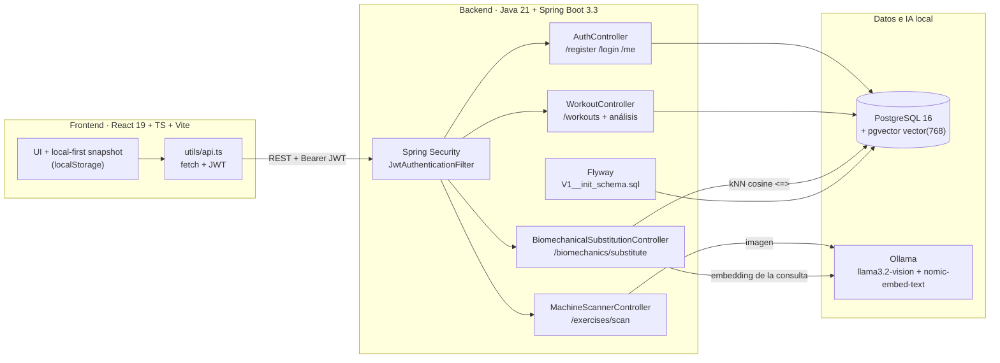

# Strength & Biomechanics Engine

[](https://github.com/pabmatang/strength-biomechanics-engine/actions/workflows/ci.yml)
[](https://openjdk.org/projects/jdk/21/)
[](https://spring.io/projects/spring-boot)
[](https://github.com/pgvector/pgvector)
[](https://react.dev/)

Aplicación full-stack de entrenamiento de fuerza con dos capacidades de IA ejecutadas en local (la interfaz se llama **CHΔNCE**):

1. **Sustitución biomecánica**: dado un ejercicio y una molestia articular, recupera alternativas del catálogo por similitud semántica usando embeddings y `pgvector`.
2. **Escaneo de máquinas**: identifica una máquina de gimnasio a partir de una foto con un modelo de visión y devuelve su grupo muscular, categoría y consejos de ajuste.

El frontend React consume **la API real** (no hay mocks de autenticación ni de IA en el flujo principal). La autenticación se valida en el backend con BCrypt y JWT y las cuentas viven en PostgreSQL. La UI guarda su snapshot de entrenamiento en `localStorage` (local-first); la tabla `workouts` se escribe a través de la API y alimenta los endpoints analíticos, no es el backup del snapshot.

> Proyecto personal de portfolio. No es un producto sanitario ni sustituye el criterio de un profesional. Las recomendaciones son informativas.

---

## Arquitectura



### Decisiones técnicas relevantes

- **Flyway es la única fuente del esquema** (`backend/src/main/resources/db/migration/V1__init_schema.sql`), incluido `CREATE EXTENSION vector` y el índice HNSW. Hibernate usa `ddl-auto: none`.
- **La columna `vector(768)` no está mapeada en JPA**: Hibernate no tiene un tipo nativo para pgvector. `BiomechanicalVectorRepository` usa `JdbcTemplate` y SQL nativo con `cast(? as vector)`.
- **La similitud que se muestra es la que calcula PostgreSQL** (`1 - (embedding <=> query)`); no hay porcentajes inventados.
- **La sustitución es recuperación, no generación**: se embebe la consulta y se ejecutan kNN. La justificación se compone de los atributos recuperados (plano, estrés articular, carga axial) para que sea trazable. No se pide al LLM que invente texto.
- **La app arranca sin Ollama**: el catálogo se siembra igualmente y la búsqueda vectorial devuelve `503` con un mensaje claro hasta que el runtime esté disponible.
- **Datos de entrenamiento local-first**: el snapshot completo (rutinas, historial, medidas…) vive en `localStorage`. Solo las cuentas y los entrenamientos creados por API se persisten en PostgreSQL; no hay un endpoint de sincronización multi-dispositivo.

---

## Stack

| Capa | Tecnología |
| :--- | :--- |
| Backend | Java 21, Spring Boot 3.3.4, Spring Security 6, Spring Data JPA, Flyway |
| IA | Spring AI `1.0.0-M1` + Ollama (`llama3.2-vision`, `nomic-embed-text`) |
| Datos | PostgreSQL 16 + pgvector (HNSW, distancia coseno) |
| Frontend | React 19, TypeScript, Vite, Tailwind CSS v4, Vitest |
| Infra | Docker Compose, Nginx, GitHub Actions |
| Tests backend | JUnit 5, Mockito, Testcontainers (`pgvector/pgvector:pg16`) |

---

## Puesta en marcha con Docker

Requisitos: Docker con Compose v2.

```bash
git clone https://github.com/pabmatang/strength-biomechanics-engine.git
cd strength-biomechanics-engine
cp .env.example .env        # ajusta JWT_SECRET_KEY antes de publicar nada
docker compose up -d --build
```

La primera vez hay que descargar los modelos en el contenedor de Ollama:

```bash
docker compose exec ollama ollama pull llama3.2-vision
docker compose exec ollama ollama pull nomic-embed-text
docker compose restart backend   # fuerza el seeding de embeddings
```

| Servicio | URL | Notas |
| :--- | :--- | :--- |
| Frontend | http://localhost:3000 | Nginx hace proxy de `/api/` al backend |
| API | http://localhost:8080 | Spring Boot |
| Swagger UI | http://localhost:8080/swagger-ui.html | OpenAPI 3 |
| Health | http://localhost:8080/actuator/health | `health,info` expuestos |
| PostgreSQL | localhost:5433 | `mia_fitness` (solo escucha en 127.0.0.1) |
| Ollama | http://localhost:11434 | Modelos locales |

### Desarrollo sin contenedores para el backend

```bash
# Solo base de datos y Ollama
docker compose up -d postgres ollama

cd backend
# El contenedor publica PostgreSQL en 5433 para no chocar con una instancia local.
SPRING_DATASOURCE_URL=jdbc:postgresql://localhost:5433/mia_fitness \
  mvn spring-boot:run       # Flyway crea el esquema al arrancar

cd ../frontend
npm ci
npm run dev                # Vite en :5173, proxy /api -> :8080
```

---

## API

Todos los endpoints salvo registro/login y la documentación requieren `Authorization: Bearer <jwt>`.

| Método | Ruta | Descripción |
| :--- | :--- | :--- |
| `POST` | `/api/v1/auth/register` | Crea la cuenta (BCrypt) y devuelve JWT + perfil |
| `POST` | `/api/v1/auth/login` | Verifica credenciales (email o usuario) y emite JWT |
| `GET` | `/api/v1/auth/me` | Perfil del usuario autenticado |
| `POST` | `/api/v1/exercises/scan` | Multipart `file` (JPEG/PNG/WebP, ≤10 MB) → `ScannedMachineDto` |
| `POST` | `/api/v1/biomechanics/substitute` | `{ currentExercise, jointDiscomfort, targetMuscle? }` → alternativas con similitud real |
| `POST` | `/api/v1/workouts` | Persiste un entrenamiento completo con series y RPE |
| `GET` | `/api/v1/workouts` | Historial del usuario autenticado |
| `GET` | `/api/v1/workouts/{id}` | Entrenamiento por ID |
| `GET` | `/api/v1/workouts/analysis/weekly-volume` | Series efectivas y tonelaje por músculo |
| `GET` | `/api/v1/workouts/analysis/plateau-detection?exerciseTemplateId=…&exerciseTitle=…` | Detección de estancamiento en la ventana de 4 semanas |

Ejemplo de sustitución:

```bash
curl -X POST http://localhost:8080/api/v1/biomechanics/substitute \
  -H "Authorization: Bearer $TOKEN" \
  -H "Content-Type: application/json" \
  -d '{"currentExercise":"Press de banca con barra","jointDiscomfort":"Hombro anterior, pinzamiento subacromial","targetMuscle":"chest"}'
```

Respuesta (recortada):

```json
[
  {
    "name": "Technogym Pure Strength Chest Press",
    "targetMuscle": "chest",
    "movementPlane": "Scapular convergent",
    "jointStressAvoided": "Low subacromial shear",
    "axialLoading": false,
    "similarityScore": 0.7149,
    "biomechanicalRationale": "Recuperado por similitud semántica (0.715) frente a 'Press de banca con barra'. Plano Scapular convergent; Low subacromial shear; sin carga axial."
  }
]
```

Errores con un contrato único (`timestamp`, `status`, `error`, `message`, `path`):

| Código | Caso |
| :--- | :--- |
| `400` | Validación de entrada o JSON mal formado |
| `401` | Credenciales incorrectas o falta el Bearer token |
| `404` | Recurso inexistente o perteneciente a otro usuario |
| `405` | Método HTTP no soportado |
| `409` | Username o email duplicado |
| `413` | Imagen mayor de 10 MB |
| `503` | Ollama/embeddings no disponible |

---

## Tests

```bash
# Backend: 18 tests unitarios (sin Docker)
cd backend && mvn test

# Backend: unitarios + 13 tests de integración con Testcontainers (requiere Docker)
cd backend && mvn verify

# Frontend: 66 tests
cd frontend && npm ci && npm test

# Build de producción (tsc + Vite)
cd frontend && npm run build
```

Los tests de integración (`AuthFlowIT`, `BiomechanicalPersistenceIT`, `WorkoutFlowIT`) arrancan `pgvector/pgvector:pg16`, aplican la migración de Flyway y comprueban:

- registro → login → `/me` con BCrypt y JWT reales;
- `401`/`409`/`400`/`404`/`405` con el contrato JSON;
- ordenación por distancia coseno y filtro por músculo en SQL;
- creación de entrenamientos con series, agregación de volumen semanal y aislamiento entre usuarios.

`AuthService`, `BiomechanicalSubstitutionService`, `ProgressiveOverloadService`, `BiomechanicalAssessmentService` y `JwtService` tienen tests unitarios con Mockito.

---

## Estructura

```
strength-biomechanics-engine/
├── .github/workflows/ci.yml        # Java 21 + Node 22: verify, lint, test, build
├── docker-compose.yml              # postgres + ollama + backend + frontend
├── .env.example
├── backend/
│   ├── Dockerfile
│   ├── pom.xml
│   └── src/
│       ├── main/java/com/mia/fitness/
│       │   ├── application/dto/        # Records de entrada/salida
│       │   ├── application/service/    # Auth, sustitución, escáner, sobrecarga
│       │   ├── domain/model/           # User, Workout, series, catálogo biomecánico
│       │   └── infrastructure/
│       │       ├── bootstrap/          # KnowledgeBaseSeeder (20 ejercicios)
│       │       ├── persistence/        # JPA + BiomechanicalVectorRepository (pgvector)
│       │       ├── security/           # JWT, UserDetailsService, CORS
│       │       └── web/                # Controllers + GlobalExceptionHandler
│       ├── main/resources/
│       │   ├── application.yml
│       │   ├── db/migration/V1__init_schema.sql
│       │   └── knowledge-base/biomechanical-exercises.json
│       └── test/
│           ├── java/...                # Unitarios (*Test) + ITs (*IT)
│           └── resources/docker-java.properties
└── frontend/
    ├── Dockerfile / nginx.conf
    ├── public/machines/                # Fotos de muestra incluidas
    └── src/
        ├── components/                 # AuthScreen, AiBiomechanicsModal...
        ├── utils/api.ts                # Cliente tipado de la API + JWT
        ├── utils/cloudSync.ts          # Sesión local y snapshots local-first
        └── __tests__/                  # 66 tests de Vitest
```

---

## Limitaciones conocidas

- **Spring AI `1.0.0-M1`**: es una versión milestone. Se mantiene porque el proyecto compila contra ella; una actualización puede requerir cambios de API.
- **Sin refresh token ni revocación**: el JWT dura 24 h (`JWT_EXPIRATION_MS`). Para producción haría falta rotación/refresh y HTTPS.
- **Ollama local**: el escaneo y la búsqueda semántica devuelven `503` si el runtime o los modelos no están disponibles. No hay fallback a un proveedor cloud.
- **Catálogo pequeño**: 20 ejercicios sembrados. La calidad del kNN depende de ese catálogo y del modelo de embeddings.
- **Snapshot no sincronizado**: el historial completo de la UI se guarda en el navegador; la tabla `workouts` se usa para los endpoints analíticos, no como backup del snapshot.
- **Bundle único**: Vite genera un chunk de ~1,1 MB (sin code splitting).
- **Datos de ejemplo en la UI**: el modal de IA permite cargar un ejemplo ilustrativo cuando el backend no está disponible, siempre con un aviso visible de que no procede de la API. El selector de comidas solo ofrece recetas de ejemplo con macros fijos; el reconocimiento de fotos de comida propias no está implementado y la interfaz lo indica.
- **Historial inicial de ejemplo**: las pantallas de peso, nutrición, medidas y comunidad arrancan con datos de ejemplo para poder probar la interfaz; no pertenecen a ninguna cuenta real y se pueden editar o borrar. Los pasos empiezan vacíos y solo se registran a mano.
- **Pasos y salud**: no hay integración con Health Connect ni Apple Health. Los pasos se registran a mano y no se generan datos sintéticos.

---

## Autor

**Pablo Mateos Angulo**

- GitHub: [@pabmatang](https://github.com/pabmatang)
- Email: [pablo-mateos@hotmail.es](mailto:pablo-mateos@hotmail.es)

Licencia MIT — ver [LICENSE](LICENSE).
